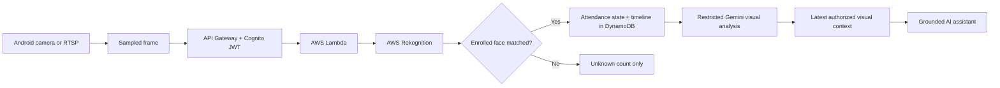
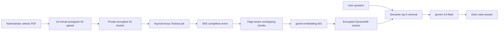

<p align="center">
  
</p>

<h1 align="center">Edge AI Beta</h1>

<p align="center">
  Consent-based classroom attendance, movement intelligence, RTSP monitoring,<br />
  conversational memory and private PDF RAG for Android.
</p>

<p align="center">
  
  
  
  
</p>

## What Edge AI does

Edge AI is a Flutter Android application for authorized classroom attendance and operations. It enrolls students from consented guided face photographs, observes camera frames, maintains a timestamped arrival/movement/exit/return timeline, and lets authorized staff ask grounded questions about live attendance or uploaded PDFs.

No custom machine-learning model is trained. AWS Rekognition manages face vectors, AWS Textract extracts PDF text, Gemini creates retrieval embeddings and short grounded responses, and the application stores operational state in encrypted AWS services.

> [!IMPORTANT]
> This is an assistive attendance system, not a forensic or disciplinary system. Face matching is probabilistic. Obtain informed consent, provide human review and follow applicable biometric, privacy and education laws.

## Features

| Area | Capability |
|---|---|
| Identity | Cognito staff sign-in, student self-sign-up, email verification, optional MFA and administrator group authorization |
| Face enrollment | Five guided poses: front, left, right, up and down; checks face count, pose, lighting, sharpness, occlusion and face size |
| Attendance | Present, absent, left and returned states with AWS-generated timestamps |
| Movement | Zone-aware events for entrance, exit, classroom and automatic left/center/right frame position |
| Mobile scanning | Scan a frame directly from the Android camera |
| RTSP monitoring | Editable RTSP URL and credentials, secure local credential storage and three-second frame sampling |
| Visual context | Restricted clothing, carried-object, posture and scene-position descriptions for already matched students |
| AI assistant | Grounded Gemini answers from current attendance and the newest authorized visual observations |
| Chat memory | Private administrator-scoped conversations, New chat and saved history; latest 20 messages support follow-up questions |
| PDF RAG | Private PDF upload, asynchronous indexing, semantic retrieval and concise answers with filename/page citations |
| Student portal | Students can see only their own profile, status and attendance timeline |
| Infrastructure | Repeatable AWS CloudFormation and PowerShell deployment from AWS CLI |
| Portable setup | First-run connection-file import and GitHub Actions deployment for recipients who do not use local CLIs |

## How it works

### Attendance and visual intelligence



Unknown faces are not sent to Gemini for identification. Gemini is called for restricted visual context only after Rekognition has matched an enrolled student and a qualifying attendance transition occurs. Analysis is rate-limited per student.

### PDF RAG



PDF uploads are limited to 15 MB. Every document, chunk and conversation is scoped to the authenticated Cognito administrator. Retrieved passages are treated as untrusted data, and the response prompt requires no more than three short sentences with citations such as `[policy.pdf p.4]`.

See [docs/ARCHITECTURE.md](docs/ARCHITECTURE.md) for data models, trust boundaries and detailed flows.

## Technology stack

| Layer | Technology | Responsibility |
|---|---|---|
| Mobile | Flutter, Dart, Android Studio | Authentication, guided enrollment, camera/RTSP scanning, dashboards, chat and PDF selection |
| Authentication | Amazon Cognito | User registration, verification, tokens, administrator groups and MFA support |
| API | API Gateway HTTP API | JWT-protected serverless routes and throttling |
| Compute | AWS Lambda, Node.js 22 | Authorization, orchestration, attendance state, retrieval and Gemini calls |
| Vision | Amazon Rekognition | Face quality checks, managed face vectors and matching |
| Documents | Amazon S3, Textract, SNS | Encrypted PDF storage and asynchronous page-aware extraction |
| Data | Amazon DynamoDB | Profiles, states, events, chat history, document metadata, chunks and embeddings |
| AI | Gemini `gemini-3.6-flash` | Short grounded attendance, visual-context and document answers |
| Retrieval | Gemini `gemini-embedding-001`, 768 dimensions | Document and question embeddings for semantic similarity |
| IaC | AWS CloudFormation, AWS CLI, PowerShell | Repeatable cloud provisioning and deployment |

The deployed design uses AWS plus Google Gemini. Firebase is not required by the current implementation.

## Repository layout

```text
edge_alpha/
|- android/                 Android host and generated launcher icons
|- assets/branding/         Source logo and adaptive-icon foreground
|- backend/                 Node.js Lambda handler and tests
|- docs/                    Architecture and feature documentation
|- infra/aws/template.yaml  Complete AWS CloudFormation stack
|- lib/                     Flutter application
|- tools/                   AWS, Google AI and Flutter scripts
|- ai_service/              Optional future Genkit service
`- test/                    Flutter tests
```

## Prerequisites

- Flutter SDK compatible with Dart `^3.10.7`
- Android Studio and Android SDK
- Node.js 22+
- PowerShell 7 or Windows PowerShell
- AWS CLI authenticated to the target AWS account
- Google Cloud CLI authenticated to a Google Cloud project
- An Android device with USB debugging enabled, or an emulator

## No-CLI deployment for another owner

Recipients do not need Flutter, Node.js, AWS CLI or Google Cloud CLI on their computer. They need a GitHub account, an AWS account and their own Gemini API key.

### 1. Fork the repository

Fork this repository into the recipient's GitHub account or organization.

### 2. Add private GitHub Actions secrets

Open **Settings -> Secrets and variables -> Actions** in the fork and create:

| Secret | Value |
|---|---|
| `AWS_ACCESS_KEY_ID` | AWS deployment identity access-key ID |
| `AWS_SECRET_ACCESS_KEY` | Matching AWS secret access key |
| `GEMINI_API_KEY` | Recipient's Gemini API key, restricted to the Generative Language API |
| `EDGE_AI_ADMIN_PASSWORD` | Strong initial Cognito administrator password |

The AWS identity must be permitted to deploy the CloudFormation resources documented in [docs/ARCHITECTURE.md](docs/ARCHITECTURE.md), including IAM roles. Prefer a temporary, dedicated deployment identity and disable or rotate its keys after deployment.

### 3. Run the workflow

1. Open **Actions -> Deploy your own Edge AI**.
2. Select **Run workflow**.
3. Enter the administrator email, AWS region and stack name.
4. Wait for the `deploy-and-package` job to finish.
5. Download the workflow artifact from the completed run.

The artifact contains:

- `Edge-AI-portable.apk` - a generic APK with no embedded cloud tenant or API key;
- `edge-ai-connection.json` - public API Gateway and Cognito connection identifiers.

The workflow APK is a beta/sideload build signed with the repository's development signing configuration. Configure a private Android release keystore before Play Store or managed-enterprise distribution.

### 4. Connect the portable application

1. Install `Edge-AI-portable.apk`.
2. Open Edge AI and choose **Import edge-ai-connection.json**.
3. Select the downloaded connection file and press **Save and connect**.
4. Sign in with the workflow administrator email/password, then rotate the initial password.

AWS credentials and the Gemini key are used only by the GitHub runner during deployment and by the private Lambda configuration afterward. They are never written to the connection file or embedded in the APK.

To build a portable APK locally without binding it to the current deployment:

```powershell
.\tools\run_edge_ai.ps1 -Action build-apk -Release -Portable
```

## Deploy from a fresh clone

### 1. Install dependencies

```powershell
flutter pub get

Push-Location backend
npm ci
Pop-Location
```

### 2. Provision Gemini access

```powershell
.\tools\provision_google_ai.ps1 -ProjectId 'your-google-cloud-project-id'
```

This writes `.edge-ai-google.json`, which is intentionally ignored by Git.

### 3. Deploy AWS

```powershell
$password = Read-Host 'Initial administrator password' -AsSecureString
.\tools\deploy_aws.ps1 `
  -AdminEmail 'admin@example.com' `
  -AdminPassword $password `
  -Region 'us-east-1'
```

The deployment script:

1. Packages production Lambda dependencies for Linux.
2. Uploads an immutable deployment artifact to S3.
3. Creates or verifies the Rekognition collection.
4. Deploys Cognito, API Gateway, Lambda, DynamoDB, private document S3, Textract and SNS through CloudFormation.
5. Creates the first administrator and writes `.edge-ai-cloud.json` for local Flutter builds.

Both local configuration files are ignored by Git. Rotate the initial administrator password before sharing access.

### 4. Run or build Android

```powershell
# Run on a connected device
.\tools\run_edge_ai.ps1

# Build a debug APK
.\tools\run_edge_ai.ps1 -Action build-apk
```

The debug APK is created at `build/app/outputs/flutter-apk/app-debug.apk`. Release builds require your own Android signing configuration and must never commit the keystore or `key.properties`.

## Using the application

### Student enrollment

1. Select **Student sign up**.
2. Verify the emailed Cognito code.
3. Enter the student name and roll number.
4. Follow the front/left/right/up/down camera prompts.
5. Submit the accepted images to create managed Rekognition face vectors.

### RTSP camera

1. Put the camera phone and Edge AI phone on the same trusted Wi-Fi network.
2. Start an RTSP Camera Server app on the camera phone.
3. Open **RTSP**, enter the URL and optional credentials, then select a zone.
4. Choose **Save & connect**, then **Start face monitoring**.

RTSP is commonly unencrypted. Prefer `rtsps://` when supported and never expose the camera port directly to the public internet.

### PDF knowledge

1. Sign in as an administrator and open **AI**.
2. Select the PDF icon, then **Upload PDF**.
3. Wait until the asynchronous status becomes **ready**.
4. Select the document and ask a focused question.
5. Use the citation in the answer to verify the source page.

## Quality checks

Run the same checks used by GitHub Actions:

```powershell
flutter analyze
flutter test

Push-Location backend
npm ci
npm test
npm audit --omit=dev
Pop-Location

Push-Location ai_service
dart pub get
dart analyze
dart test
Pop-Location

aws cloudformation validate-template `
  --template-body file://infra/aws/template.yaml
```

## Security and privacy

- Raw enrollment photos and scanned camera frames are processed in memory and are not retained by this implementation.
- PDFs are stored in a private, versioned, AES-256-encrypted S3 bucket with all public access blocked.
- DynamoDB encryption and point-in-time recovery are enabled.
- Private API routes require Cognito JWTs; staff functions additionally require the `admins` group.
- Gemini credentials remain in Lambda configuration and are never bundled into Android.
- RTSP credentials are stored locally with Android secure storage.
- Prompt instructions treat attendance records, chat memory and retrieved document passages as untrusted data.
- Production deployments should define explicit biometric, attendance, PDF and chat retention/deletion policies.

Read [SECURITY.md](SECURITY.md) before a public or institutional deployment.

## Known limitations

- Attendance accuracy depends on camera position, lighting, enrollment quality and the configured match threshold.
- Three-second frame sampling is not equivalent to continuous forensic video.
- Student self-sign-up verifies email ownership but not institutional membership; add domain restrictions or staff approval for production.
- The current default session ID is `current`; multi-class deployments should introduce scheduled class/session management.
- DynamoDB vector retrieval is appropriate for the current bounded 300-chunk-per-document design. Large multi-document corpora should move to a managed vector index.
- The VLC dependency significantly increases APK size and carries distribution-notice obligations.

## Contributing

See [CONTRIBUTING.md](CONTRIBUTING.md). Security issues should follow [SECURITY.md](SECURITY.md), not a public issue.
