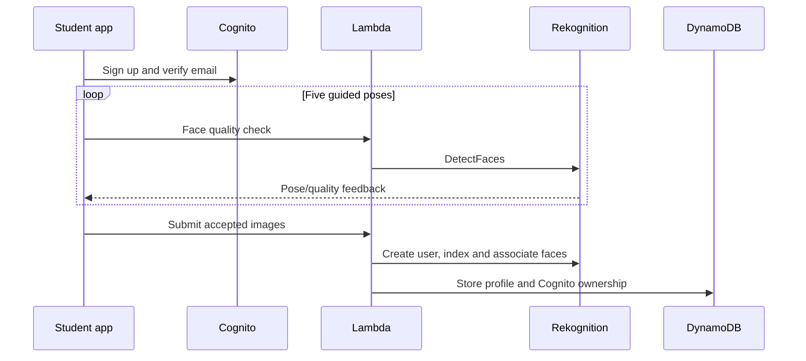

# Edge AI architecture

## System boundary

Edge AI has two trusted application tiers:

1. The Flutter client collects explicit user input, captures authorized images, renders operational data and holds short-lived Cognito tokens.
2. The AWS backend authorizes every private operation, calls Rekognition/Textract/Gemini, and persists only the state required by the feature.

The Android application never receives AWS credentials or a Gemini API key. It calls only JWT-protected API Gateway routes and time-limited S3 upload URLs.

The standard deployment workflow embeds only the API URL, AWS region, Cognito User Pool ID and public App Client ID in its tenant-specific APK. A fresh installation therefore opens directly to authentication without a configuration form. These values identify public endpoints and are not credentials; AWS credentials and Gemini keys remain in GitHub deployment secrets and the private backend. An optional portable build contains no tenant configuration and retains the connection-file import screen for advanced multi-deployment use.

## Components

| Component | Purpose | Sensitive data handled |
|---|---|---|
| Flutter Android | Camera, RTSP, enrollment UX, attendance views, assistant and PDF upload | Camera frames, RTSP credentials, Cognito tokens |
| Cognito | Registration, verification, authentication and groups | Email, password verifier, MFA state |
| API Gateway | JWT verification, routing and throttling | Access token claims |
| Lambda | Business rules and service orchestration | Images in memory, attendance, document passages |
| Rekognition | Face quality, indexing and matching | Managed biometric vectors and transient images |
| DynamoDB | Application state and retrieval corpus | Profiles, events, chat, extracted text and embeddings |
| S3 | Original administrator PDFs | Encrypted private PDF objects |
| Textract + SNS | Asynchronous page-aware text extraction | PDF text and job metadata |
| Gemini API | Visual description, embeddings and grounded answers | Restricted prompt context sent by Lambda |

## Authorization model

- Every private API route requires a Cognito JWT.
- `identityFromEvent` reads the immutable Cognito `sub` and group claims from API Gateway's authorizer context.
- Staff operations call `requireAdmin` and require the `admins` Cognito group.
- Student operations call `requireIdentity` and derive the student record from the authenticated `sub`; the client cannot select another student ID.
- Chat and PDF partition keys include the administrator `sub`, preventing cross-account reads even if an identifier is guessed.

## Core flows

### Student enrollment

Enrollment images are not written to S3 or DynamoDB by this implementation.

### Frame processing and attendance state

1. A camera or RTSP frame is submitted with a session, camera and zone.
2. Lambda normalizes the image and asks Rekognition to search managed face users.
3. Matches below the configured threshold are treated as unknown.
4. The state machine derives `ARRIVED`, `MOVED`, `LEFT`, `RETURNED` or no transition.
5. Current state and immutable timeline events are written with server timestamps.
6. For a qualifying matched transition, Gemini may describe only clothing, carried objects, posture and coarse scene position.
7. The newest allowed visual observation becomes available to the assistant.

### Assistant and memory

- Conversation metadata uses `pk=USER#{sub}`, `sk=CHAT#{conversationId}`.
- Messages use `pk=CHAT#{sub}#{conversationId}` and time-ordered message keys.
- At most the latest 20 messages are included as untrusted conversational memory.
- Current attendance is always refreshed from the authorized session; memory cannot override live state.
- Visual answers use only the latest stored visual observation for the matched student.

### PDF RAG

1. Lambda validates the filename and 15 MB size limit, creates ownership metadata and returns a 10-minute presigned S3 PUT URL.
2. The client uploads directly to the private S3 bucket, avoiding API Gateway payload limits.
3. Lambda starts asynchronous Textract text detection with an idempotent document token.
4. Textract publishes completion to SNS, which invokes Lambda.
5. Lambda downloads all Textract result pages and creates overlapping page-aware chunks of at most roughly 1,200 characters, capped at 300 chunks.
6. `gemini-embedding-001` embeds chunks with `RETRIEVAL_DOCUMENT` at 768 dimensions.
7. A question is embedded with `RETRIEVAL_QUERY`; Lambda computes cosine similarity and selects the top five passages.
8. `gemini-3.6-flash` receives only those passages, chat memory and strict grounding instructions.
9. The answer is restricted to three short sentences with filename/page citations.

## DynamoDB key patterns

| Entity | Partition key | Sort key |
|---|---|---|
| Student profile | `STUDENT#{studentId}` | `PROFILE` |
| Attendance state | session/student scoped | state key defined in handler |
| Timeline event | `STUDENT#{studentId}` | `EVENT#{timestamp}#{uuid}` |
| Conversation | `USER#{cognitoSub}` | `CHAT#{conversationId}` |
| Chat message | `CHAT#{sub}#{conversationId}` | `MESSAGE#{timestamp}#{order}#{uuid}` |
| PDF metadata | `USER#{cognitoSub}` | `DOCUMENT#{documentId}` |
| PDF chunk | `DOCUMENT#{sub}#{documentId}` | `CHUNK#{index}` |
| Textract mapping | `TEXTRACT_JOB#{jobId}` | `METADATA` |

The table uses on-demand billing, server-side encryption, a general-purpose session/event GSI and point-in-time recovery.

## API surface

| Method and route | Role | Purpose |
|---|---|---|
| `GET /health` | Public | Service health |
| `GET /me` | Authenticated | Role and owned profile |
| `GET /me/attendance` | Student | Own attendance only |
| `POST /me/face-check` | Authenticated | Guided pose validation |
| `POST /me/enroll` | Student | Self-enrollment |
| `GET /students` | Admin | Roster |
| `POST /students/enroll` | Admin | Staff-managed enrollment |
| `POST /frames/scan` | Admin | Frame matching and event processing |
| `GET /sessions/{id}/dashboard` | Admin | Live session state |
| `GET /students/{id}/timeline` | Admin | Student event timeline |
| `POST /assistant` | Admin | Attendance or PDF-grounded answer |
| `GET /assistant/chats` | Admin | Account-scoped chat list |
| `GET /assistant/chats/{id}` | Admin | Account-scoped messages |
| `GET /documents` | Admin | Account-scoped PDF list/status |
| `POST /documents/upload` | Admin | Presigned upload initialization |
| `POST /documents/{id}/ingest` | Admin | Start asynchronous indexing |

## Production hardening checklist

- Restrict CORS origins to the production application domains.
- Use a custom KMS key when organizational policy requires customer-managed encryption.
- Add deletion workflows and explicit retention durations for biometrics, events, chats and documents.
- Add institutional-domain checks or staff approval for student registration.
- Use separate scheduled session IDs for classes and terms.
- Add alarms for Lambda errors/throttles, Textract failures and assistant latency.
- Move large document collections to a managed vector index instead of bounded DynamoDB retrieval.
- Perform a DPIA/privacy review and validate regional data residency requirements.
